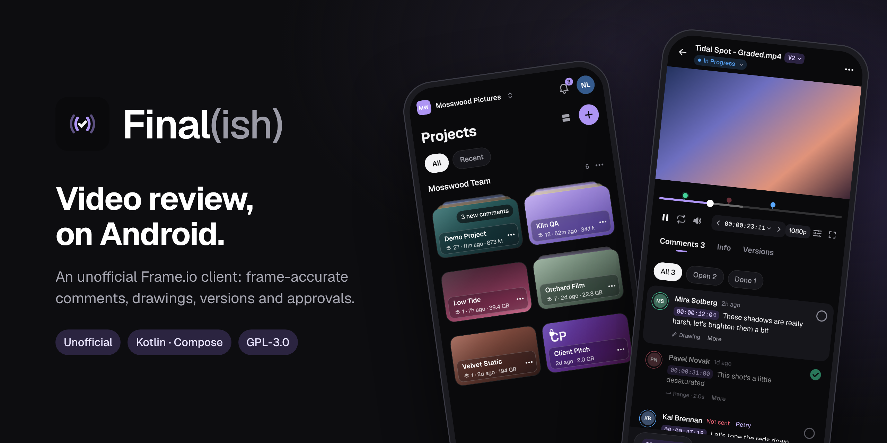
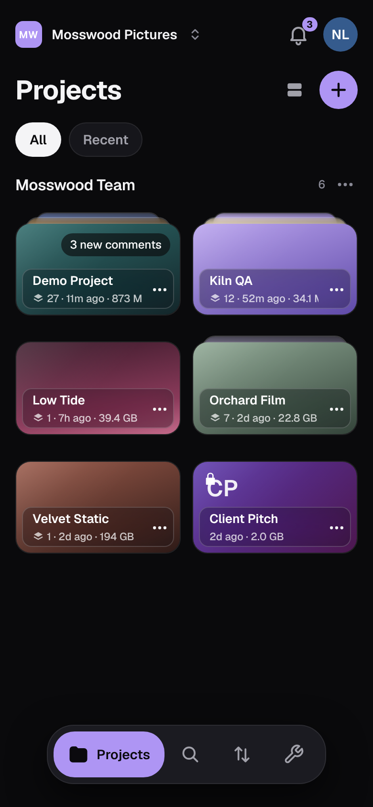
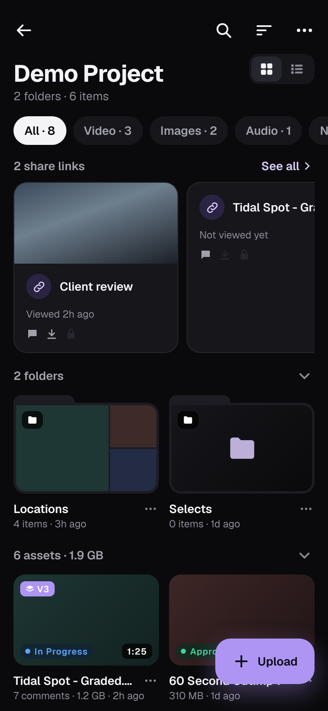
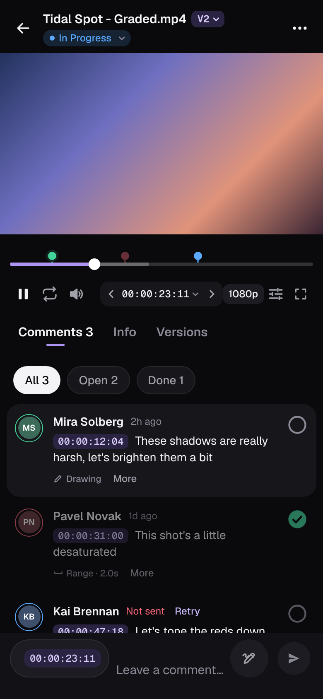
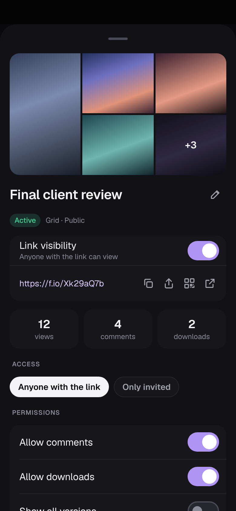
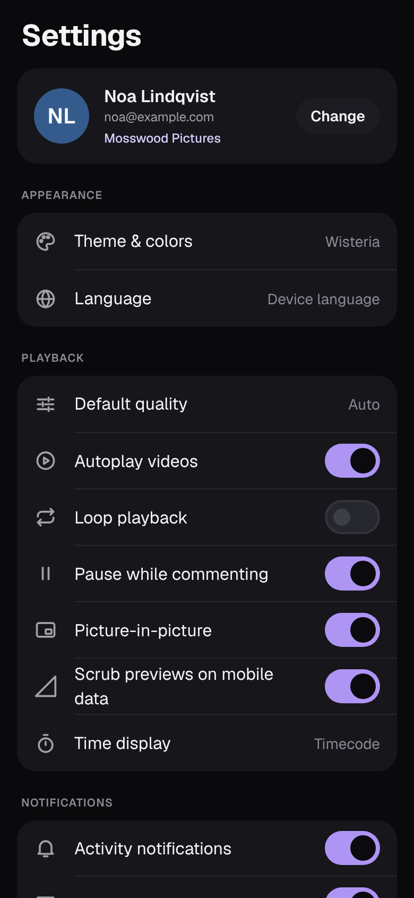
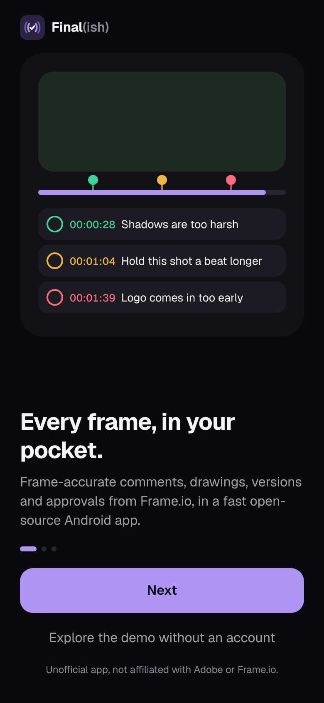
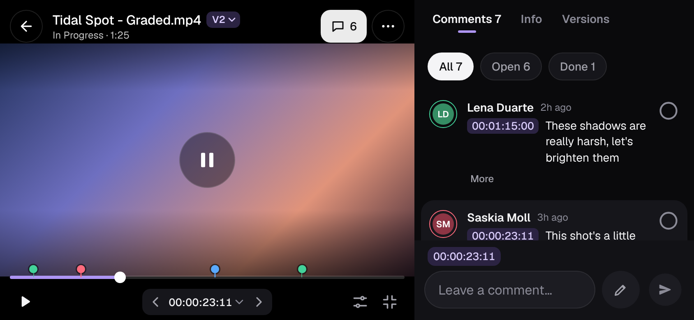

<p align="center">
  
</p>

<p align="center">
  <a href="https://github.com/TeoVader/finalish/actions/workflows/android.yml"></a>
  <a href="LICENSE"></a>
  
  
  
  
</p>

# Final(ish)

*Open source. Native. Unofficial Frame.io client.*

**A free, open-source, unofficial [Frame.io](https://frame.io) client for Android.**
Review videos, leave time-coded comments, approve versions and share review links from your Android phone
or tablet. Built with Kotlin, Jetpack Compose and Media3, designed to feel fast and look great.
Website: [teovader.github.io/finalish](https://teovader.github.io/finalish/) ·
Download: [latest APK](https://github.com/TeoVader/finalish/releases/latest).

Frame.io has no official Android app (as of 2026). Final(ish) brings the Frame.io review workflow to
Android phones and tablets, using the official Frame.io **V4** API.

**Which Frame.io accounts work.** Final(ish) uses the Frame.io V4 API and signs in with an Adobe ID.
Accounts managed by Adobe (Adobe Admin Console) work. Accounts managed by Frame.io work once the user signs
in to Frame.io with an Adobe ID that uses the same email; without that link Frame.io's API answers
"Frame user is not linked to an Adobe ID". Frame.io plans to move every Frame-managed account to Adobe management; no date is announced yet, organizations are moved
automatically when scheduled (admins get notice about 30 days ahead and can ask support@frame.io for a
different date). See [Frame managed vs Adobe managed accounts](https://help.frame.io/en/articles/13719174-frame-managed-vs-adobe-managed-accounts)
and [the migration to Adobe-managed subscriptions](https://help.frame.io/en/articles/10552820-understanding-the-migration-to-adobe-managed-frame-subscriptions-and-users).

Legacy (V3) accounts don't work. Frame.io moved its remaining Legacy retail accounts to V4
[as of June 1, 2026](https://help.frame.io/en/articles/15291379-adobe-after-effects-frame-io-v4-panel-overview).
If yours is still on Legacy, an Owner or Admin can [update it from the account menu on frame.io](https://help.frame.io/en/articles/11534393-what-to-expect-when-updating-to-v4-a-comprehensive-guide-for-updating-your-account-on-a-free-pro-or-team-plan),
or ask support@frame.io. Accounts created with Google before the move to Adobe may need Frame.io support
to link them to an Adobe ID.

> [!NOTE]
> Final(ish) is not affiliated with, endorsed or sponsored by Adobe or Frame.io. Adobe and Frame.io are
> either registered trademarks or trademarks of Adobe in the United States and/or other countries.

**Contents:** [Screenshots](#screenshots) · [Features](#features) · [Download and build](#download-and-build) ·
[How this was built](#how-this-was-built) · [Contributing](#contributing) · [Support](#support) · [License](#license)

## Screenshots

<table>
  <tr>
    <td></td>
    <td></td>
    <td></td>
  </tr>
  <tr>
    <td align="center">Projects</td>
    <td align="center">Folders and files</td>
    <td align="center">Player and comments</td>
  </tr>
  <tr>
    <td></td>
    <td></td>
    <td></td>
  </tr>
  <tr>
    <td align="center">Share links</td>
    <td align="center">Settings</td>
    <td align="center">Welcome and demo mode</td>
  </tr>
</table>

<p align="center">
  <br>
  <sub>Landscape: the player beside the comments</sub>
</p>

## Features

- **Browse** accounts, workspaces, projects, folders, version stacks and collections, in a grid or a list, with live refresh.
- **Play** video frame by frame with timecode, speed, loop, real resolutions, pinch-zoom, aspect masks and safe guides, and picture-in-picture.
- **Review** with time-coded and range comments, on-frame drawings, mark as done and markers on the timeline.
- **Open** images (RAW, PSD and more), PDFs, audio and Word / Excel / PowerPoint files.
- **Approve** with Status, Rating and custom metadata fields, and **compare** versions side by side or with a wipe.
- **Share** links with every setting, and open `next.frame.io` / `f.io` links straight in the app.
- **Upload** in the background with resumable multi-part transfers, from the picker or the share sheet.
- **Work offline**: saved files, cached browsing and comments that sync later.
- **Get notified** of new comments, mentions, processed uploads and opened links, with no server.
- **Phones and tablets**: on wide screens the tab bar becomes a side bar and lists keep a readable width.
- **Six languages**: English, Italiano, Deutsch, Español, Français and Português (Brasil), switchable in Settings.
- **Report bugs** by shaking the phone: logs are sanitised and the screenshot is only attached if you turn it on.
- **Try it first** in demo mode, no account needed. Works on every Frame.io plan, Free included.

The full list, area by area, and what the Frame.io API doesn't allow yet: [docs/features.md](docs/features.md).

## Download and build

Download the signed APK from [Releases](https://github.com/TeoVader/finalish/releases/latest) (pre-release,
Android 8.0 or later); Google Play will follow. Or build it yourself with JDK 21 and the Android SDK:

```bash
./gradlew assembleDebug        # app/build/outputs/apk/debug/
```

A debug build needs your own free Adobe Developer credential to sign in (or use demo mode, no account needed).
Setup, release signing, tests and the code layout: [docs/building.md](docs/building.md).

## How this was built

Final(ish) is an **AI-assisted** project. Most of the code was written with
[Claude Code](https://claude.com/claude-code), Anthropic's coding agent, working from my direction: I decide
what the app does and how it looks, review the results and test every change on real phones. Every commit
made with Claude says so in a `Co-Authored-By` line.

AI-written code still has to earn its place, so every change goes through the same checks:

- **Unit and screenshot tests** (Roborazzi) for the logic and for every screen, run by CI on each push
  together with Android lint, which has to stay at zero warnings.
- **Code reviews and audits** of the whole codebase, with the findings fixed and tracked in the history.
- **Real devices**: a current Pixel and an older OnePlus 5, on a paid and on a Free Frame.io plan.
- **In-app reports**, so bugs found in daily use get fixed quickly.

If you spot something that looks wrong, [open an issue](https://github.com/TeoVader/finalish/issues/new/choose):
that is exactly the kind of feedback this approach needs.

## Contributing

Bug reports and ideas are welcome: shake the phone in the app (or Settings → Report a bug), or open an
[issue](https://github.com/TeoVader/finalish/issues/new/choose). Code changes: [CONTRIBUTING.md](CONTRIBUTING.md).
Security issues: [SECURITY.md](SECURITY.md).

## Support

Final(ish) is free, with no ads and no tracking. If it saves you time, you can
[buy me a coffee on Ko-fi](https://ko-fi.com/teovader). Starring the repository, reporting bugs and
telling other editors about it help just as much.

## License

Free software under the [GNU GPL v3.0](LICENSE). Not affiliated with Adobe or Frame.io (see the note above).
